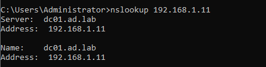

- Configured a DNS reverse lookup zone, updated DC PTR, and verified reverse name resolution using `nslookup 192.168.1.11`, successfully resolving the domain controller's IP address to `dc01.ad.lab`.

- Troubleshot VMware NAT connectivity by identifying a subnet mismatch between DC01 and VMnet8.
- Reconfigured VMware NAT networking to match the lab subnet (`192.168.1.0/24`).
- Verified external network connectivity with ping and DNS resolution using `nslookup www.google.com`.